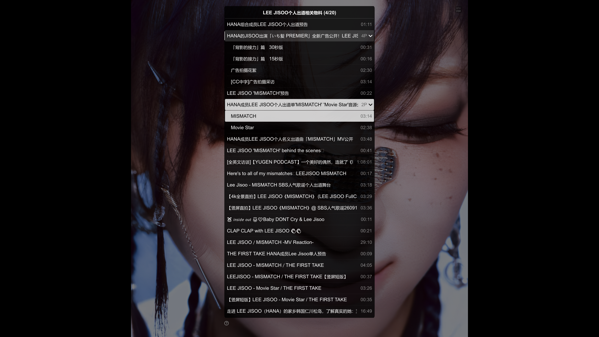

# B站完整合集与分 P 层级播放列表验证

日期：2026-10-13。浏览器用户脚本：External Player **1.2.14.21**。

本次将列表交接从优先使用当前投稿分 P，改为优先交接完整合集，并补齐合集中每个视频的所有分 P。MPV 在同一播放列表面板展示父视频与缩进子项；单 P 视频直接播放，不增加只有一个子项的父目录。当前源码及本机安装已完成，尚未包含在 `v2026.10.12-progress-update` 的 `.19` 累计 Release 中。

## 真实页面结果

实测页面：[BV1CabT6vEdp](https://www.bilibili.com/video/BV1CabT6vEdp/)。网页显示合集“LEE JISOO个人出道相关物料”，当前视频为第 4 / 20 个。

完整交接包含 **20 个视频、24 个可播放条目**：18 个单 P 视频、一个 4 P 视频、一个 2 P 视频。所有分 P 均进入 MPV 原生播放列表，父项只负责展开和收起，不成为播放条目。接收完整清单的 IPC 确认返回 `stage: commit`、`ok: true`、`itemCount: 24`。

| 实测项目 | 结果 |
|---|---|
| 当前视频自动展开 | “MISMATCH”和“Movie Star”缩进显示，合集标题显示 `(4/20)`。 |
| 4 P 视频 | 全部显示“30秒版”“15秒版”“广告拍摄花絮”“[CC中字]广告拍摄采访”；第 4 P 实际播放成功。 |
| 单 P 视频 | 直接点击“个人出道预告”播放，源为 1920×900、独立 AAC 音轨，无额外子层。 |
| 收起与再次展开 | 收起当前 2 P 后可见行数从 22 降为 20；再展开 4 P 后为 24。原生条目数始终为 24，播放 CID 未改变。 |
| 重开菜单 | 手动收起 4 P 后关闭、重新打开面板，收起状态保留。 |
| 原生乱序后点选 | 打乱原生列表，再选择“Movie Star”，仍打开 CID `41672575247`；界面保留合集原顺序。 |
| 顺序播放 | 首条预告片尾自动进入广告视频第 1 P，实际 CID `41563914342`，位置约 0.08 秒。 |
| 单曲循环 | “Movie Star”到片尾后重播当前 P，CID 不变，位置回到零秒。 |
| 列表循环 | 最后一个视频到片尾后返回合集首条；续播记录仍按各 CID 独立处理。 |
| 切换清晰度 | “Movie Star”由 1080×1080 切换至 360×360，列表仍为 24 条、当前索引及位置保持。 |
| 分 P 续播 | 切换其他视频后返回“MISMATCH”，恢复到先前保存的 64.44 秒。 |
| 音轨与弹幕 | 返回“MISMATCH”后实际加载 HEVC 视频、AAC 音频与选中的 ASS 弹幕轨。 |
| 全屏与显示 | 网页启动自动全屏；已核对 4P、2P 及 `1:08:01` 等完整时长不会被长标题挤掉。 |

下图是安装最终显示修正后，通过真实 MPV `screenshot-to-file window` 保存的窗口截图：

真实页面测试使用网页按钮启动播放器，随后通过该独立测试会话的 Windows IPC 调用生产 uosc 菜单处理器及原生播放控制，并读取实际 CID、媒体参数、列表和菜单状态；不是模拟浏览器或菜单模型。验证完成后关闭本次测试播放器及独立测试页。

## 数量与传输验证

没有两条或 500 条的数量截断。缺少多 P 详情时最多三个并发请求补齐，上传及恢复分页约 48 KiB，播放器清单按不超过 32 KiB 的 IPC 消息传递，并逐块确认。公开元数据总预算为 32 MiB，最多八个会话；超过预算明确报错，不悄悄输出部分合集。

完整清单置于独立的 `user-data/mpv-lazy/web-playlist-manifest`，轮询属性只保留短能力信息和确认，避免将大型清单混入后台常规 IPC 响应。菜单点选按 MPV 实时条目 ID 查找，折叠或乱序不会让显示行号误指向其他视频。

自动化回归共 **460 项通过**：

- 用户脚本 Node 测试 130 项：完整合集优先、缺失 P 补齐、分块重试、分页恢复、迟到解析和 HTTP／WebSocket 通道。
- 中继 Python 测试 106 项：注册及归属校验、完整分 P 校验、重复提交、IPC 清单确认和媒体参数。
- 发布工具与播放器 Lua 测试 224 项：树结构、选集、焦点／折叠保持、循环、画质、弹幕、进度及打包校验。

另运行两项真实 MPV 本地媒体集成测试，两项均通过：

- `smoke_test_web_playlist_hierarchy.py`：**1001 个原生条目、996 个视频**，含 3 P／4 P；验证完整数量、单 P 无子目录、当前祖先自动展开、折叠保留原生列表、乱序后准确选 P、下一条，以及长媒体地址。
- `smoke_test_web_playlist.py`：兼容旧注册方式的两个原生条目，验证 uosc 乱序及下一条、单曲循环、列表循环、画质切换保留位置、独立进度及长媒体地址。

本地集成使用模拟浏览器解析和本地媒体；1001 条目是规模与传输验证，不代表实际在线请求了 1001 个 B站媒体源。真实在线验证范围为上述 20 视频、24 分 P 合集。

## 构建与本机安装

新构建 Windows x64 中继 EXE 已通过冻结程序健康接口、WebSocket、HTTP 进度、旧列表及分块层级列表验证，Brotli 二进制已包含。构建环境为 Python 3.14.7、websockets 17.2、Brotli 1.2.0、PyInstaller 6.22.3。

- EXE SHA256：`2953047f51c20c68057eb81655e22cee8b05cc92a3f5e08830d30320b5e04d0f`。
- `.21.user.js` 与仓库 `external_player.js` 完全一致，SHA256：`10d5789ce673cf39f8af4e704fa7c55282456ed9d34c8cda8b7445490c857a73`。
- `/health` 保持 `webPlaylistApiVersion: 1` 兼容旧脚本，并新增 `webPlaylistHierarchyApiVersion: 1` 与 `webPlaylistChunkApiVersion: 1`。
- 本机可运行整合包已同步 18 个配套文件；最终安装前后 **65 个现有设置／历史文件**逐个 SHA256 一致，变更文件另有备份。测试期间新生成的观看记录属于正常播放行为。
- 用户已导入 `.21` 并禁用重复旧版，本次实际交接来自新版脚本。

## 使用范围

适用于 B站普通 BV／av 投稿、合集及分 P。保持原网页打开，后续条目需要使用浏览器现有账号重新解析；每个条目分别处理画质、音轨、弹幕 CID 和进度。相关推荐不进入列表。番剧影视、互动分支及 DRM 媒体尚未接入。

使用与更新文件说明见 [网页视频列表](../scripts/web-playlist.md)。
