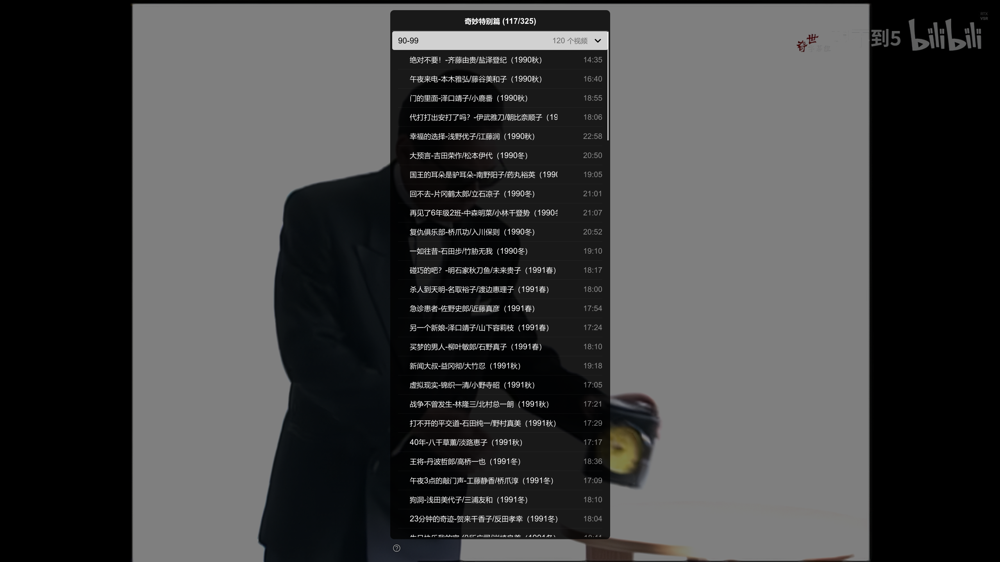

# 重复项清理、问题修复与大合集快速启动验证

日期：2026-10-14。浏览器用户脚本：External Player **1.2.14.24**。

本次完成项目重复项清理，并修复大合集移交等待、列表后台扩展、浏览器刷新恢复、画质切换和弹幕传输中的问题。源码及配套中继已经同步到本机可运行整合包；用户已导入 `.24`。这些变更尚未发布为新的 GitHub Release。

## 大合集解析等待的原因与处理

问题页面为 [BV1p393YCEFV](https://www.bilibili.com/video/BV1p393YCEFV/)，所属合集“奇妙特别篇”共有 **325 个视频**，当前视频位于第 117 个。

此前移交流程在启动播放器之前等待完整合集元数据。合集接口附带的 `pages` 信息可能只包含首 P，不能直接当作完整分 P 列表；为避免遗漏，需要继续获取各投稿的详情。大合集的详情补齐、重试及上传因此进入了启动的等待路径。网页解析和播放器首次解析还会重复请求当前视频的播放源。

旧版测试曾在点击后约 59 秒仍观察到“正在启动本地浏览器中继”。这只是按钮长时间等待的观测，不是精确首帧测量，不能据此计算新版的提速倍数。

新版先使用当前 CID 注册只有当前条目的启动列表，取得源后立即发出播放器启动指令。完整合集和全部分 P 在后台补齐，再扩展同一个原生播放列表。不会为了减少等待而截断合集，也不会把尚未完成的单条启动列表显示成完整的 `1/1` 合集。

| 阶段 | 当前行为 |
|---|---|
| 进入视频页面 | 仅预取当前投稿元数据，不在每次页面打开时预取整份合集。 |
| 用户点击移交 | 当前源解析和完整分 P 元数据补齐并行开始。 |
| 启动播放器 | 当前 CID 的单条启动列表就绪即可启动，不等待全合集补齐。 |
| 后台列表扩展 | 复用同一会话、IPC 管道和列表 ID；分块上传完整清单，经原生列表扩展及清单确认后才标记完成。 |
| 元数据失败 | 当前视频继续播放，列表面板显示加载失败，不将部分清单冒充完整合集。 |

同一网页内的重复请求通过有限的内存缓存合并：当前投稿元数据最多 2 条、分 P 详情最多 32 条，均保留 60 秒；同一 `aid/cid/epid/fnval` 的播放源最多 4 条、保留 15 秒；公开 WBI 签名密钥保留 10 分钟。播放源中的签名地址不写入持久化配置。元数据请求有超时，切换页面后迟到的解析结果也不能覆盖新页面的媒体。

`.23` 联机复测发现后台仍会为各视频调用 `view`，每次响应都可能重复整份 325 视频合集；单次详情请求失败也会让完整补齐停止。`.24` 改用播放器现有的 `/x/player/pagelist` 接口获取完整页数组，初始当前投稿仍使用 `view`。真实公开接口已核对目标视频的单 P，以及 `BV1CabT6vEdp` 的两个 P；后者第 2 P 的 CID `41672575247` 与此前真实播放一致。页序必须连续，CID 不得重复，已知 CID 和预期 P 数必须一致；缺失时明确拒绝。后台超时、网络错误和 HTTP 5xx 仅重试一次，HTTP 412、风控或其他 API 拒绝不重试。

后台扩展保留当前原生条目 ID、播放位置、暂停状态、画质及音轨／字幕轨。即使完整元数据早于播放器启动返回，初始 M3U 仍先提供当前条目，等首次媒体解析提交成功后再扩展，避免把首个视频重新加载一次。

## 重复项清理

| 项目 | 修改及验证 |
|---|---|
| `input_uosc.conf` | 清理 12 个按键上的 15 条冗余定义。对同名按键保留清理前实际生效的命令；清理前后有效按键到命令的映射一致，真实 MPV 输入配置解析通过。 |
| ArtCNN 预设 | 原先完全相同的 `SR_ARTCNN_NV_2025.vpy` 和 `SR_ARTCNN_NV_2K.vpy` 共用后者实现。旧文件名保留为兼容入口，通过 `runpy` 传入 `video_in`，现有菜单或观看记录引用仍可使用。 |
| 忽略规则 | 使用通用 `__pycache__/`，移除已被通用缓存／日志规则覆盖的重复路径规则。 |
| 工程说明 | 更新仓库目录说明中的旧磁盘路径和失效仓库描述，补充当前脚本与构建验证要求。 |

对 4292 个 Git 跟踪文件进行内容哈希检查，共发现 59 组完全相同的文件。其中 57 组属于不同历史基准测试的相同标准错误输出，保留各次实验记录；两份 Base64 模块分别服务于独立脚本的加载范围，也予以保留。没有删除模型、用户设置或观看历史。已自定义的本机预设不会被统一预设覆盖。

ArtCNN 兼容入口另通过真实 `VSPipe --info` 验证，使用隔离的空白测试片，确认 `video_in` 能传入共享脚本并产生有效输出。该检查验证入口兼容性，不代表对 ArtCNN 模型进行了新的性能基准测试。

## 修复的问题

| 问题 | 修复后的行为 |
|---|---|
| 自动移交早于界面初始化 | 等待控件就绪再调用播放，提示／加载组件也可按需安全创建，避免错误处理本身再抛空组件异常。 |
| 后台请求失败原因不可辨认 | 记录固定原因、数值 HTTP／API 码、公开 aid 及请求／完成数量，不记录异常原文、签名地址、账号信息或请求对象。 |
| HTTP 兜底遗漏合集完成／失败事件 | HTTP 轮询和 WebSocket 都转发 `webPlaylistMetadataReady`、`webPlaylistMetadataFailed`，浏览器可以收到最终列表状态。 |
| 刷新网页后遗留旧上传 | 在同一锁内转移会话归属并清理旧浏览器未完成的扩展上传，新浏览器可从第 0 块继续；保留播放器、待解析条目与进度会话。 |
| 浏览器切换归属时漏发解析请求 | 记录实际接收解析请求的浏览器，避免旧请求发送完成后误把新浏览器标成已接收。 |
| 首帧前确认属性尚不存在 | 清单及列表扩展共用有超时的确认等待。暂时缺失属性或管道忙时继续等到期限；明确拒绝仍立即报告，超时仍有错误反馈。 |
| 后到的启动清单覆盖失败状态 | 同一版本已失败时，迟到的 `pending` 清单不能再把面板改回“正在加载”；新的完整版本确认后才恢复就绪。 |
| 启动清单和完整清单竞争发布 | 启动发布器使用自己的版本快照；完整扩展已经接管发布时，旧发布器不再覆盖新清单。 |
| 清晰度重载丢失续播位置 | 忽略加载中或已处于清晰度切换的重复重载。合并两处恢复回调，按目标媒体地址恢复位置，并在失败、替换或 15 秒超时后清理，防止迟到回调跳转另一视频。 |
| 普通视频自动弹幕加载异常 | CID 查询失败且自动加载未提供回调时，使用默认回调正常返回，避免异步处理抛出空回调异常。 |
| 含大量引号／反斜杠的直播弹幕超出 IPC 上限 | 按实际最终 UTF-8 JSON 命令的字节数拆分批次，同时计入弹幕 JSON 作为字符串时的第二层转义；不再仅按内层文本大小估算。 |
| 列表注册及发布校验不足 | 保留旧完整注册方式，拒绝与预留分块上传冲突的注册；更新包构建必须包含冻结 EXE 的快速启动验证通过标志。 |

IPC 预算检查与实际写入使用同一个编码函数。列表清单每块最多 100 项，按最终 IPC 命令不超过 32 KiB 拆分；网页上传仍采用约 48 KiB 分块。完整公开元数据预算为 32 MiB，最多八个逻辑会话，超过预算明确报错。视频／分 P 数量没有两条或 500 条的任意截断。

## 回归与真实 MPV 本机验证

自动化回归共 **529 项通过**：

- 浏览器用户脚本 Node 测试 **158 项**：请求合并、当前条目快速启动、完整合集补齐、分块上传／恢复、迟到结果隔离及 HTTP 状态通知。
- 中继 Python 测试 **121 项**：注册与归属、刷新后的上传恢复、首媒体门控、清单／扩展确认、最终 IPC 字节预算和错误反馈。
- 发布工具及播放器 Lua 测试 **250 项**：原生列表扩展、菜单状态、失败保护、画质恢复、弹幕／进度及冻结构建校验。

以下集成测试调用真实 MPV 和 Windows IPC，使用本地媒体及模拟浏览器解析：

| 测试 | 验证结果 |
|---|---|
| 完整元数据晚于播放启动 | 先播放当前单条，再扩展到 **1001 个原生条目／996 个视频**，含 3 P 和 4 P 投稿；当前原生 ID、轨道、位置、暂停和画质均保持。 |
| 完整元数据早于播放器启动 | 仍先启动当前条目，再扩展到同样的 1001 条；首次媒体解析只执行一次，不重载当前视频。 |
| 层级列表操作 | 当前祖先自动展开，单 P 无多余子目录，折叠不改变原生条目数；原生乱序后准确选 P，下一条及长媒体地址通过。 |
| 旧两条目注册方式 | 手动选择、uosc 乱序和下一条、单曲循环、列表循环、清晰度切换保留列表和位置、独立条目进度均通过。 |

1001 条目测试验证规模、传输和播放器状态保持，没有在线请求 1001 个 B站媒体源。之前 `.21` 的 20 视频／24 分 P 真实网页结果见 [完整合集与分 P 验证报告](2026-10-13-web-playlist-hierarchy.md)，不作为本次 `.24` 的新在线测试结果。

## 真实网页复测

已从 B站搜索页点击 `BV1p393YCEFV` 结果进入新页面，使用用户导入的 `.24` 和本机配套播放器／中继。保持用户原有自动移交设置开启，未点击 MPV 启动按钮；自动移交成功，未再出现 Toast／Loading 初始化异常。

下表以自动移交流程开始为零点，读取脚本 `handoff_timing` 中的实际毫秒值。网页打开时间及精确首帧时间没有单独测量，不把启动指令当作首帧，也不与旧版非同口径观测计算倍数。

| 阶段 | 本次耗时 |
|---|---|
| 当前视频源解析完成 | 3.076 秒 |
| 当前 CID 单条启动列表注册 | 3.494 秒 |
| 播放器启动指令发出 | 3.868 秒 |
| 首个视频源提交给中继 | 4.753 秒 |
| 全部 325 视频／325 条目元数据就绪 | 59.226 秒 |
| 完整清单上传完成 | 60.006 秒 |
| 原生扩展与清单确认完成 | 60.286 秒 |

后台实际补齐另外 **324 个视频**，诊断显示请求／完成数均为 324，后台详情耗时 56.120 秒。页面所属三分节“90-99”“00-09”“10-19”完整交接，没有截断。当前视频从单条启动列表的第 1 项移到完整列表的第 **117／325** 项，CID 仍为 `40272266649`。

播放期间通过本次独立测试会话的真实 Windows IPC 连续采样；在完整清单完成前暂停于 **45.779125 秒**。完成后原生 ID、媒体地址哈希、源 generation `1`、同一播放位置、暂停状态均保持一致，实际视频为 **1920×1080 HEVC**，选中 AAC 音轨与 ASS 弹幕轨，全屏状态保持。扩展没有重新解析或重载当前视频。后台完成与就绪通知成功到达浏览器。

下图为本次真实 MPV 的窗口截图，显示完整合集总数和分节菜单：

本次在线范围是目标 325 视频合集的自动启动及完整扩展；循环、乱序、切画质与多 P 的兼容检查由前述真实本机集成和既有在线层级验证覆盖。验证结束后仅关闭本次独立播放器和测试页，保留用户正在观看另一视频的窗口与页面。

## 构建与本机安装

最终 Windows 中继 EXE 已重新构建，并通过冻结程序的健康接口、WebSocket、HTTP 进度、旧列表、分块层级列表及快速启动测试。构建环境为 Python 3.14.7、websockets 17.2、Brotli 1.2.0、PyInstaller 6.22.3。健康接口保留旧列表能力，并新增 `webPlaylistFastStartApiVersion: 1`。

| 文件 | SHA256 |
|---|---|
| `bilibili-live-bridge.exe` | `dae54965dfdf46ea2a3e2bf4e49ab82a31fe0d8cad6bce61cad30adc1a455a32` |
| `external-player-1.2.14.24.user.js`／仓库 `external_player.js` | `d71cb0978bb15550561e95b2412214c0d2d6eaa0f537e2cc15b208da8bc4427c` |

最终安装前后 **73 个已有设置／观看历史文件**逐个 SHA256 保持一致，变化的程序文件留有备份。输入配置按实际生效命令清理重复项，用户已修改的预设保留。播放测试中新产生的观看进度属于正常运行记录，不用于宣称历史文件从不变化。

使用方法与更新入口见 [网页播放列表](../scripts/web-playlist.md)、[External Player](../scripts/external-player.md)；冻结构建及打包要求见 [发布工具说明](../../tools/release/README.md)。
