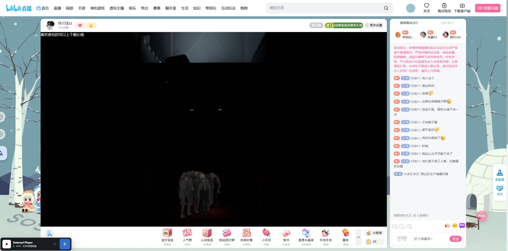

# 外部播放器交接后暂停原网页直播

日期：2026-10-14。源码用户脚本：External Player **1.2.14.27**。这是已发布 `.26` 累计包之后的源码补丁，尚未创建新 Release。

## 问题与原因

用户最终指定的页面为 [30040584 直播间](https://live.bilibili.com/30040584)，活动标题为 `2026OWCS-S3`。该页面本身没有视频节点，直播位于 `/blanc/30040584?liteVersion=true` 的 iframe。旧 `.26` 页面显示已交给 MPV，但嵌入视频的实测状态仍为 `paused=false`。

- 旧基础暂停方法只扫描本 document，以约 0、1.5、3、4.5、6 秒重试。晚加载、重新连接或后续视频重建可在重试结束后继续播放。
- iframe 解析器只向单个已记录窗口转发暂停，漏掉父页面的视频及后续替换的 iframe。
- 有限重试没有导航与用户操作边界，既可能漏掉新节点，也可能覆盖用户已主动恢复的播放。

## 修复行为

成功移交且所选播放器启用“自动暂停”后，脚本立即暂停现有视频，监听后续播放与 DOM 视频／iframe 替换，并通过现有约 500 毫秒扫描补齐。暂停状态绑定当前页面／内容；解析或协议分发失败时不暂停，明确关闭自动暂停时保持原选择。

父子 iframe 使用每次交接的独立标识传递暂停与解除。子页面初始化后发送独立就绪消息，恢复过早发出的暂停指令；初始化、导航及重建的本地清理不会误通知父页面解除整组暂停。来自其他窗口、过期标识或非法标识的消息被拒绝。

用户真实点击视频画面、播放按钮或使用播放快捷键后，网页可恢复播放，并向父页面解除同次交接的暂停状态。画质／音量控件、聊天输入及程序模拟手势不会作为恢复播放的许可。网页视频保持暂停不等于站点停止 MSE、网络请求或后台缓存。

## 当前验证

| 验证 | 结果 |
|---|---|
| 全部用户脚本回归 | **196 项通过**；包括 23 项独立暂停状态测试和 19 项直播交接测试 |
| 延迟和节点重建 | 模拟 65 秒后自动播放、新视频节点、嵌套／替换 iframe、同 WindowProxy 导航及早期指令丢失均通过 |
| 恢复与隔离 | 主动播放、快捷键、过期手势、聊天输入、音量／画质操作、错误窗口、旧标识及关闭设置均通过 |
| 成功／失败交接 | 真实源码的 iframe 解析至协议分发路径验证：父页也暂停；关闭自动暂停或协议分发失败不暂停 |
| 本机安装 | `.27` 脚本已备份并安装，84 份已有偏好／观看历史文件哈希保持一致；播放器与中继未改动 |
| 指定直播间 `.27` 联机复测 | 用户已导入 `.27`；`30040584` 当前返回 `Bilibili room is not live`，iframe 无视频节点，无法进行开播状态验证；旧 `.26` 故障复现不计为通过 |
| 正在直播的页面暂停 | `32465207` 实测 MPV 为 1920×1080、正常播放至 37.682 秒；网页视频同为 1920×1080，保持 `paused=true`、位置 `3.050112` 秒，超出旧重试窗口后仍暂停 |
| 主动恢复和断线重连 | 离线回归通过；本次联机中页面随后进入加载／重连状态并移除视频节点，未完成真实恢复及重连的正向验证，不作为已通过项目 |

`.27` 脚本 SHA-256：`7adab2417978bf0afb38ab5a4871c2a95330469c18c0896a1840afe30c329c86`。源码与可导入文件内容一致。原始本机证据保存于忽略目录 `tools/telegram-web-mpv-bridge/build/live-browser-pause-20261014/` 的 `node-tests.log` 和 `install-result.json`。

实际网页／播放器的安全字段另存 `online-page-27.json`、`online-native-27.json`。测试另外检查了用户此前提供的 `14466268`，当时也未得到可播放节点。活动页 iframe 的修复由回归验证覆盖，本次真实暂停结果来自普通直播页，不把它等同于已完成指定活动页的 iframe 实测。全部测试页面和自己创建的播放器窗口在结束后清理。

导入 `external-player-1.2.14.27.user.js` 后禁用 `.26` 和重复旧脚本，完整刷新直播页；确认所选播放器的“自动暂停”仍开启。本次补丁不需要更换 EXE 或播放器 Lua。
